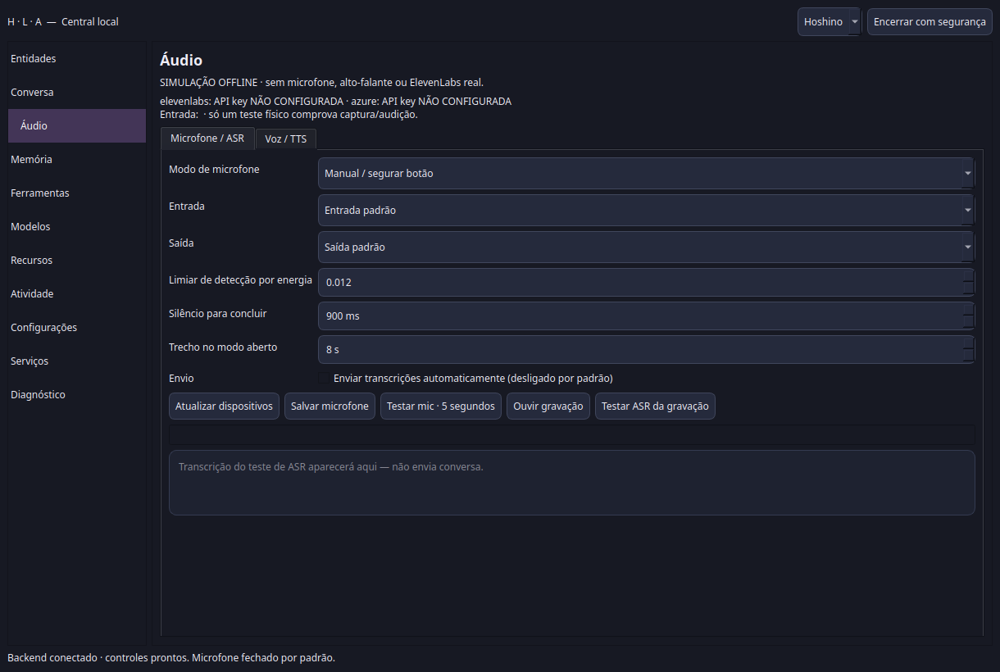

# Central nativa, microfone, voz e manutenção de memória

## Resultado e limite da validação

SIM, MAS é necessário encerrar/reabrir o backend antigo e fazer o teste físico.
A operação cotidiana agora usa janela QtWidgets própria, sem navegador e sem
WebView. O backend em execução durante o desenvolvimento não foi reiniciado,
as entidades reais não foram encerradas e nenhuma memória real foi apagada.

Baseline antes das mudanças: **72/72 grupos offline**. Depois: **73/73 grupos
offline**, sem falhas. Novo grupo: **28/28 casos**, incluindo quatro casos PCM,
mais **15/15 contratos da janela Qt real com transporte/processos simulados**.
A abertura/fechamento Qt também foi testada contra servidor HTTP real de
fixture; fechar a janela não envia shutdown ao backend.

Isso NÃO certifica microfone, alto-falante, ElevenLabs, Minecraft ou sessão
prolongada reais. Nenhuma chamada real paga foi realizada nesta rodada.

## Arquitetura preservada

QtWidgets → HTTP loopback autenticado existente → Supervisor, AudioService,
diagnostics/history/job_bus e Resource Manager atuais. Não existe segundo
backend de IA, scheduler ou banco mental. PyQt5, parec, paplay e pactl já
estavam instalados. Não foram instalados novos frameworks ou baixados modelos.

O iniciador existente passa a abrir a janela nativa por padrão. A interface
HTML permanece disponível pela opção explícita `--browser`, como compatibilidade.
Orbes existentes agora abrem/focam a central nativa. Fechar a janela cancela
sua captura/player/áudio pendente, não desliga as entidades. Para desligar o
backend, usar **Encerrar com segurança**.

## Microfone

Aba **Áudio → Microfone / ASR**:

- Entrada e saída selecionáveis, com inventário solicitado pelo usuário.
- Manual/segurar botão; aberto em trechos; detecção por energia com pausa após silêncio.
- Limiar, tempo de silêncio e duração do trecho configuráveis/persistentes.
- Nível de entrada, gravação de teste de cinco segundos, ouvir gravação e teste ASR separado.
- Transcrição de teste visível, sem enviar conversa. PCM de teste fica somente na janela.
- Rascunho por padrão; envio automático é opcional e desligado por padrão.

Nenhum microfone abre ao iniciar a central. **Gravar / Concluir**, na conversa,
abre o modo salvo; **Segure para falar** usa manual durante a pressão do botão.
A origem `native_microphone` acompanha a transcrição até o contexto. Trocar
de entidade durante ASR não redireciona a fala. Envio automático não recebe
o marcador fictício de revisão humana; captura não identifica biometricamente
quem falou.

Gate energético é detecção simples, não reconhecimento de locutor. Durante
fala sintetizada a captura contínua é pausada e retomada somente se o usuário
a havia aberto. Não há cancelamento por voz full-duplex certificado; botão de
interrupção/PTT/nova mensagem têm prioridade. Um ASR fica pendente por janela;
trechos adicionais sob sobrecarga são descartados com aviso explícito, não
acumulados sem limite. Silêncio e ruído ambiente precisam de ajuste no teste físico.

## Voz

Aba **Áudio → Voz / TTS** permite frase personalizada e escolha entre os
executores ElevenLabs suportados: `eleven_multilingual_v2`, `eleven_flash_v2_5`
e `eleven_turbo_v2_5`. São modelos de fala do provider já existente, não novos
LLMs locais. Referência: [documentação oficial ElevenLabs](https://elevenlabs.io/docs/overview/models).

Teste isolado não acorda LLM e funciona com Hoshino/Lilith dormindo. Save de
configuração não sintetiza nem consome quota; teste externo exige confirmação.
Salve habilitação e Voice IDs antes de testar. Modelo do teste é um snapshot
isolado: não altera defaults e não é silenciosamente sobrescrito por variável
de modelo do ambiente.

Correções:

- Estado dormindo não cancela o teste isolado de Hoshino.
- Teste explícito de ElevenLabs/Azure sem configuração é recusado claramente,
  antes de enfileirar síntese; não é apresentado como teste daquele provider.
- Falhas remotas em operação configurada continuam permitindo fallback local.
- Provider/voz/modelo efetivamente usados aparecem no rodapé após síntese.
- Escolher Qwen reutiliza o worker/fallback existente, sem executar Kokoro por engano.
- Chunks são reproduzidos na ordem; EOF/erro do stream mantém invalidação existente.
- Relatos do player nativo são marcados como nativos, nunca como prova de audição humana.
- Falha de início do player limpa estado/arquivo temporário; fechamento também cancela áudio próprio que chegou atrasado.

ElevenLabs no backend real consultado nesta rodada:

| Campo | Estado observado |
|---|---|
| Preferencial | elevenlabs |
| Habilitado | true |
| API key no processo atual | **NÃO CONFIGURADA** |
| Hoshino Voice ID | jotBQRDYDizrWQAbv9VO |
| Lilith Voice ID | m151rjrbWXbBqyq56tly |
| Azure | desativado |

Os IDs reais já estavam corretos e foram preservados. Não lemos/exibimos o
conteúdo da chave. Ela continua exclusivamente no ambiente
`ELEVENLABS_API_KEY`. O processo antigo não herda alterações de ambiente feitas
depois que iniciou; reabrir com ambiente atualizado é obrigatório para testar
ElevenLabs. A autorização/autenticação e quota da conta ainda não foram testadas.

Kokoro continua preservado; quando seu worker não é o ativo, a escolha requer
configuração/restart, sem fingir que a troca ocorreu. Checkpoints locais ASR/TTS
continuam os existentes, sem selector que invente compatibilidade/download.

## Ferramentas

Ativar/desativar por entidade na página **Ferramentas**, agrupada por categoria.
A política fica em `compartilhado/config/interface.json`, com revisão/backup,
preservando configurações desconhecidas. Dispatcher e Alistair filtram schemas
e recusam chamadas desativadas antes do handler. Não existe dispatcher paralelo.
Uma chamada mutável já iniciada não é cancelada retroativamente.

Configuração ilegível ou com formato inválido bloqueia execução explicitamente;
não concede acesso em silêncio. Erro de ferramenta desativada não vira sucesso.

## Exclusão de memórias — exatamente o escopo autorizado

Página **Memória**, por entidade: busca, seleção múltipla, senha de exclusão,
apagar selecionadas e apagar todas **da entidade selecionada**.

Senha definida pelo usuário na janela, mínimo oito caracteres, hash scrypt com
salt aleatório; jamais senha em claro em configuração/diagnóstico. Não é a
senha do Linux. Troca exige senha anterior; tentativas incorretas são limitadas.

Requisitos de execução:

1. Entidade dormindo/offline, sem processo/job/lease ativo; lock de lifecycle mantido.
2. Prévia dos registros e resumos derivados; confirmação e senha.
3. Fingerprint revalidado: banco mudou, recusa e exige nova prévia.
4. Espaço para backup SQLite consistente e cópia do índice vetorial, mais margem de 1 GiB.
5. Remoção do índice por IDs, SQL e verificação por leitura independente.
6. Request ID durável; sucesso confirmado pode ser consultado novamente, efeito incerto não é repetido.

Tabelas cobertas: memories, properties, episodes, reflections, procedures,
context_summaries e alistair_turns. Resumos derivados são invalidados também
na exclusão específica. Limpeza total inclui vetores órfãos das três coleções
mentais existentes dessa entidade. Backup fica no runtime da entidade em
`memory-backups/manual-<id>`; não há restauração automática após resultado incerto.

**Preserva identidade, personalidade, relações, traços, configurações, modelos,
recibos e caixa postal/histórico bruto.** Exclusão aqui significa remover os
registros mentais selecionados, não todas as cópias do que foi dito. Conversas
antigas continuam podendo voltar ao contexto ou ser aprendidas novamente;
a prévia avisa isso. Cópias de backup também conservam os registros anteriores.

Nenhuma migração cega. SQL/vetores reais não foram alterados. A exclusão efetiva
foi exercitada em bancos temporários; Chroma real temporário, embeddings
explícitos, sem modelo/download/rede. Falha vetorial preserva SQL e marca
resultado incerto, com backup. Identidade/relações/traços e outro banco ficaram intactos.

## Arquivos

Modificados:

- iniciar_entidades.py
- app/core/central_control.py
- app/core/audio_service.py
- app/core/audio_transcription.py
- app/core/tts_router.py
- app/core/dispatch.py
- app/alistair_runner.py
- app/ui/central.html
- app/ui/control.js
- app/ui/overlay.py
- testes/central_browser.cjs
- testes/catalogo.py

Criados:

- app/core/ui_policy.py
- app/core/memory_maintenance.py
- app/ui/native_audio.py
- app/ui/central_native.py
- testes/test_central_refinamento.py
- testes/native_central_contracts.py
- docs/ARQUITETURA_REFINAMENTO_NATIVO_20261007.md
- este relatório e a screenshot de fixture abaixo.

Backup inicial de fontes: `arquivo/central_refinamento_20261007/fontes_antes.tar.gz`.
Ele contém dez arquivos principais anteriores; não é backup integral do projeto.
O .desktop existente não foi substituído: aponta para o mesmo iniciador.
Permissões de `.profile` foram restringidas; sua chave não foi escrita por nós.

## Endpoints/configurações

No mesmo servidor existente:

- GET/POST `/api/control/microphone`: modos/dispositivos/parâmetros.
- POST `/api/control/tools`: política por entidade.
- GET/POST `/api/control/password`: apenas booleano configurado ao ler, definição/troca ao gravar.
- POST `/api/control/memory/preview` e `/api/control/memory/delete`: prévia/manutenção confirmada.
- POST `/api/control/native/open`: abrir/focar janela nativa.
- `/api/audio/transcribe`: aceita origem native_microphone.
- `/api/audio/test`: texto/provider/modelo explícitos, entidade dormindo permitida no teste.
- `/api/audio/job`: relato de player browser/native, sem alegação de audição.
- `/api/control/audio`: modelo TTS allowlisted e flags sem segredo.
- `/api/control/focus`: distingue cliente nativo para balões/orbes existentes.

JSON visual existente guarda microfone e ferramentas desativadas. JSON de áudio
existente guarda provider/IDs/modelo. `central_security.json` é configuração de
hash de senha, **não banco mental**. Nenhuma API aceita guardar chave remota.

## Testes e medições

Suíte completa antes/depois; grupos específicos de central, áudio, streaming,
providers e regressões novas. Validação de compilação/importação Python e
`central_native.py --verify`. Regressões cobrem escopo de memória/backup/índice,
senha/locks/idempotência, falhas/incerteza, política real do dispatcher,
snapshot/provider, origem ASR, captura manual/aberta/detecção, interrupção,
troca de destinatário, processo que falha ao iniciar, áudio tardio ao fechar e
estado de reprodução. Browser legado também continua testado com transporte simulado.

Ensaio Qt **offscreen/software**, backend de fixture, cerca de 11,9 segundos:
RSS de pico **81.368 KiB (~79,5 MiB)**, CPU do loop **0,239 s**, média **2,01%
de um núcleo**. Inclui pedidos iniciais e polling; não é medida de uso prolongado
nem de GPU/compositor real. Polls: estado 2 s, painel 5 s, áudio 350 ms somente
se houver job. Memória/edição não são recarregadas periodicamente destruindo a
seleção; chat evita renderizar HTML idêntico. Animação do overlay existente
não foi recalibrada nesta rodada.

Máquina observada: 31 GiB RAM, 8 GiB swap ativo (0 em uso), 83 GiB livres em
disco. Resource Manager, seus limites/margens e concurrency_validated=false
foram preservados; não houve otimização/calibração de GPU nesta rodada.

## Como testar agora

1. Na central antiga, **Encerrar com segurança** e aguardar o encerramento.
   Só fechar a aba/janela não encerra o backend.
2. Se a chave foi colocada em `.profile`, sair e entrar na sessão Linux antes
   de reabrir, para o lançador herdar o ambiente atualizado.
3. Abrir `/home/gustavo/hoshino e lilith/Hoshino e Lilith.desktop`.
4. Áudio → Microfone / ASR: atualizar dispositivos, escolher entrada/saída,
   salvar, gravar cinco segundos, ouvir e testar ASR. Teste não envia conversa.
5. Áudio → Voz / TTS: confirmar API key CONFIGURADA, escolher ElevenLabs,
   habilitar, conferir IDs, salvar, digitar frase/modelo e clicar Testar Hoshino/Lilith.
6. Só depois testar modos contínuos e leitura de respostas durante conversa.
7. Para manutenção: dormir a entidade, abrir Memória, definir senha e revisar
   prévia. Não apagar banco real só para validar interface.

## Riscos/pendências

Microfone/saída e provider real dependem do teste humano. Não foram validados
full-duplex, ruído real, latência de conta ElevenLabs, quota, uso prolongado ou
compositor GPU. Painéis avançados de recursos/atividade/serviços usam leitura
estruturada; a janela não replica cada controle avançado de arquivos do HTML
legado (por exemplo, cancelamento de transferência pela UI nativa ainda não
tem botão dedicado). Modelos locais ASR/TTS e parte das configurações avançadas
continuam read-only/requerem restart. Não é certificação de paridade visual total.

Nenhuma falha da suíte permanece; as falhas de implementação/fixtures encontradas
foram corrigidas com regressões, incluindo sombreamento de config no dispatcher,
provider local errado, estado preso após FailedToStart e resposta tardia de áudio.
Não há alegação de que testes simulados validaram hardware ou conta reais.
